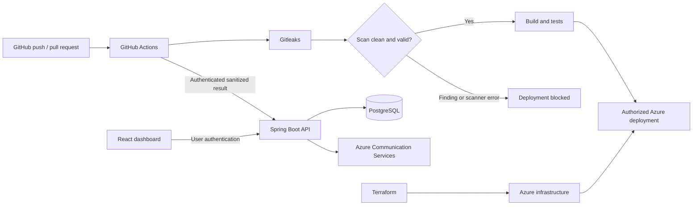

# Secret Shield — Project Overview

Reviewed on 11 October 2026. Implementation checklist: [MODULE_TODO.md](MODULE_TODO.md).

## Purpose and scope

Secret Shield is a cloud-based DevSecOps platform that detects credentials committed to GitHub repositories, prevents unsafe deployments, and helps users review and track the resulting incidents. Gitleaks supplies the detection engine; this project builds the automation, backend, dashboard, and cloud infrastructure around it.

The final demonstration must show:

1. A GitHub push automatically starts a scan.
2. A clean scan permits the deployment path.
3. A scan containing a synthetic secret blocks deployment and creates findings.
4. The dashboard displays repository, branch, commit, scan outcome, severity, and incidents.
5. Incidents move through Open, Resolved, and Ignored with recorded reasons and history.
6. High-risk findings produce Azure Communication Services notifications.
7. Docker packages the application and Terraform provisions its Azure infrastructure.

## Evidence used and current status

Sources:

- `progress.pdf`, 9 pages: previous progress, local-first development, pending authentication checks, and implementation sequence.
- `CCD_Synopsis.pdf`, 4 pages: project scope, nine functional modules, Azure architecture, and success criteria.
- This repository: tracked source, Maven configuration, application configuration, and test source.

The PDFs are project evidence, not commands to execute. Their historical instructions to start the server or add a temporary endpoint were not executed during this review. New design choices below are proposals for future implementation.

| Area | What exists in this checkout | What remains |
| --- | --- | --- |
| Backend foundation | Java 21; Spring Boot parent version `4.1.1` as declared in `pom.xml`; Maven wrapper; web, JPA, validation, security, PostgreSQL and JJWT dependencies | Reproduce startup/build on both machines; document setup |
| Database | Environment-based PostgreSQL connection; `users` entity/table mapping | Versioned migrations, remaining tables, reproducible test database |
| Registration | Input DTO validation, duplicate prechecks, BCrypt password hashing, default `DEVELOPER` role, safe response DTO | Duplicate conflicts and validation errors currently reach the generic handler; normalization and concurrency-safe conflict handling |
| Login | Password verification, signed one-hour JWT, custom invalid-credentials exception mapped to 401 | Automated coverage and complete protected-request verification |
| Protected requests | JWT filter loads user and sets authorities; all routes except login/register require authentication | Explicit JSON 401/403 handling and verification for missing/invalid/expired tokens |
| Health | `GET /api/health` returns `Secret Shield API is running` | It currently requires authentication; define separate minimal public liveness behavior for hosting |
| Roles | Stored as a String; authorities use `ROLE_` prefix | Structured roles, controlled admin setup, repository ownership and authorization |
| Error responses | `ApiResponse` exists; authentication errors use it | Successful auth responses are direct DTOs; generic errors are strings; choose and enforce one documented contract |
| Tests | One `@SpringBootTest` context-load test | Functional, authorization, persistence, scanner, and pipeline tests |
| Other project features | No repository/scan/finding/incident code, frontend, scanner integration, workflows, Docker, or Terraform in tracked files | All remaining modules in the todo |

The progress PDF reports successful local startup, PostgreSQL connection, registration, and login. Those are historical observations. This review inspected source and did not rerun the application or tests, so authentication is **implemented but not fully verified**, rather than marked complete.

Other concrete gaps: `ddl-auto` is `update`, timestamps are assigned manually, `open-in-view` is not explicitly configured, and `.gitignore` does not currently cover `.env` or Terraform state. The generated development-password message reported in the PDF requires investigation; its cause is not established by this review.

## Intended architecture

Two integrations develop separately before joining:

- **Local learning path:** scan a controlled local fixture with Gitleaks; import sanitized results into the backend; inspect findings and incidents in the dashboard.
- **Final pipeline path:** GitHub Actions runs Gitleaks directly, enforces its own deployment gate, and submits sanitized results through a separate machine-authenticated API. A dashboard outage must never turn an unsafe scan into a successful deployment.

The gate applies to the repository and commit being scanned. For the project demo, that can be this application repository; demonstrate synthetic-secret commits on an isolated test branch. Do not deploy arbitrary connected repositories using Secret Shield's Azure credentials. Future remote on-demand scans, GitHub OAuth/App installation, and multi-repository deployment orchestration are outside the initial implementation.

## Functional modules from the synopsis

| Synopsis module | Responsibility | Todo modules |
| --- | --- | --- |
| Authentication and role management | Register/login, user identity, administrators, repository permissions | M02–M03 |
| Repository and scan management | Connected repository metadata, ownership, branch/commit identity, scan lifecycle | M04–M05 |
| Secret detection and CI/CD integration | Gitleaks execution, sanitized result ingestion, automated triggers | M06, M12 |
| Security gate and deployment prevention | Block findings and scanner failures; allow only the scanned clean commit | M09, M12 |
| Findings and severity management | Safe finding metadata, deduplication, documented severity mapping | M07 |
| Security dashboard | Summary APIs, React pages, filters and details | M11 |
| Incident management | Open/Resolved/Ignored lifecycle and reasons | M08 |
| Notification | High-risk alerts through Azure Communication Services | M10 |
| Audit and history | Immutable event records and authorized history views | M08, M11 |

M00–M01 and M13–M16 provide collaboration, persistence, containerization, infrastructure, deployment, and final verification needed to deliver these modules.

## Proposed backend model

These names and relationships are planning choices to finalize in M01, not existing entities.

| Entity | Key fields and relationships |
| --- | --- |
| User | Existing ID, username, normalized email, password hash, structured role, creation timestamp |
| ProjectRepository | Owner User, GitHub owner/name, canonical URL, default branch, active flag |
| Scan | ProjectRepository, commit SHA, branch, trigger, workflow run/attempt, start/end timestamps, status, scanner version |
| Finding | Scan, stable fingerprint, rule ID, severity, file path, line, commit, sanitized description |
| Incident | ProjectRepository, stable finding identity, Open/Resolved/Ignored status, reason, actor, timestamps; linked scan occurrences |
| AuditEvent | Repository context, actor type/ID, operation, target, safe change summary, timestamp |
| NotificationDelivery | Incident/event reference, recipient configuration reference, delivery status, attempt count, safe error, timestamp |

Suggested scan statuses: `QUEUED`, `RUNNING`, `CLEAN`, `FINDINGS_DETECTED`, `FAILED`. Keep scanner failures distinct from secret findings. Gate outcomes can be `ALLOW` or `BLOCK` with a reason.

An incident's review status does not change the scan outcome. Resolving an incident means recording remediation; it must not imply that a credential was automatically rotated. Ignoring an incident must not silently bypass the deployment gate. An explicit, reviewed scanner allowlist would be a separate future policy if needed.

## Security and integration rules

- Every user API checks repository ownership or administrator permission, including nested scan/finding/incident IDs. Authentication alone is insufficient.
- Normal registration always creates a developer. Admin provisioning is controlled by Member 1; never accept an arbitrary role from public registration.
- CI result submission uses repository-scoped machine authentication, not a developer's interactive JWT. It validates repository, commit, run identity, payload size, and retry identity.
- Store and display finding metadata, never full exposed secrets, matching source snippets, raw Gitleaks reports, passwords, or authentication tokens. Omit secret values entirely rather than relying on partial masking.
- Use only unmistakably synthetic credentials in fixtures and demonstrations. Review scanner reports before any file enters Git or a public workflow artifact.
- Run Gitleaks using fixed arguments and a controlled workspace, with timeout and size limits. Pin and verify its version and CLI/report format when implementing M06.
- An unsafe scan, scanner crash, timeout, or malformed/missing result blocks deployment. A clean CI scan can remain safely gated even if reporting is unavailable, but reporting retries/failures must be visible.
- Keep database/JWT/ACS/machine credentials outside Git. Terraform state and saved plans may contain sensitive values and must stay outside the repository.
- Define and test the frontend session approach in M02/M11. If cookies are selected, revisit CSRF and cross-origin settings; current CSRF disabling must not be copied blindly.

## Team ownership

| Member | Primary deliverables |
| --- | --- |
| Member 1 — you | Backend implementation, authentication/authorization, persistence, scanner execution and ingestion, security gates, notifications, API integration, GitHub Actions, Docker, Terraform, Azure deployment, automated security/integration testing |
| Member 2 — teammate | Frontend visual components and page layouts against supplied fixtures/contracts, project explanation and API documentation, manual acceptance checklist, diagrams, screenshots, demo guide and presentation |

Member 1 provides fixed DTO shapes, fixtures, page component props, and shared frontend setup before Member 2 implements pages. Member 1 owns authentication state, API client, route protection, mutation behavior, and shared dependency changes. Member 2's page components consume supplied data and callbacks. Ownership is explicit at each step in the todo; neither member needs to edit the other's shared files during parallel work.

## Delivery order

Finish authentication and establish contracts/migrations first. Build repository and scan records, then local scanning, findings, and incidents. Add gate behavior, notifications, and dashboard integration. Add GitHub Actions and Docker after the local flow works; provision and deploy to Azure after the same packaged flow is reproducible locally.

Member 2 can prepare documentation while Member 1 completes the backend, and build fixture-driven pages once M11.1 publishes frontend contracts. Cloud setup follows local verification; no subscription resources need to be created merely to start the next todo step.

The definitive task order, dependencies, and completion evidence are in [MODULE_TODO.md](MODULE_TODO.md).
