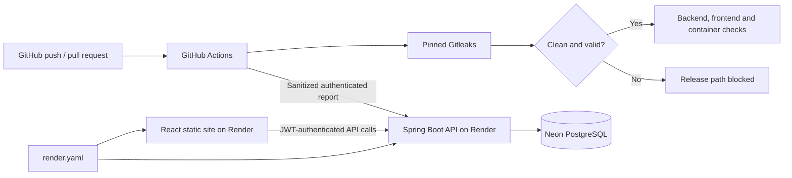

# Secret Shield project overview

Secret Shield is a DevSecOps platform that detects exposed credentials, blocks
unsafe delivery, and provides an authenticated dashboard for investigating scans,
findings, incidents, notifications, and audit history.

## Current portfolio deployment

- React static frontend: <https://secret-shield-zboc5k.onrender.com>
- Spring Boot Docker API:
  <https://secret-shield-api-zboc5k.onrender.com/api/health/live>
- PostgreSQL: managed Neon database with Flyway migrations
- CI/CD: GitHub Actions with pinned Gitleaks, tests, builds, and fail-closed gates
- Hosting declaration: `render.yaml`, deployed only after required checks pass

The free Render backend sleeps after inactivity and may take about a minute to
wake. Azure Communication Services notification sending is disabled on current
hosting, but verified delivery and failure/retry evidence remains in the project.

## Architecture

The gate is independent of dashboard availability: a finding, scanner error,
timeout, malformed report, or missing required acknowledgement fails closed.
Only rule ID, path, line, severity, fingerprint, and run identity are retained;
raw matched secret values are never sent to the dashboard or ordinary artifacts.

## Implemented capabilities

- Registration, login, logout, one-hour JWT sessions, and DEVELOPER/ADMIN roles
- Owner-scoped repositories, scans, findings, incidents, notifications, and audit
- Repository-scoped hashed CI credentials with expiry and revocation
- Local bounded scanner execution and machine-authenticated CI result ingestion
- Idempotent run/attempt reporting and deterministic finding fingerprints
- Clean/finding/scanner-error gate decisions that cannot be bypassed by incident status
- Incident Open, Resolved, and Ignored transitions with reasons and history
- Retryable notification outbox with fake and Azure Communication Services providers
- Responsive React dashboard, filters, details, transitions, and safe error states
- Docker Compose stack, GHCR exact-commit images, and infrastructure as code

## Verified Azure project phase

For the academic presentation, Terraform provisioned 18 Azure application
resources: two Linux App Services on one B1 plan, Key Vault, managed identities,
GitHub OIDC federation, VNet/subnet integration, role assignments, Azure
Communication Services, and an Azure-managed email domain. Neon remained the
database, and Terraform state used a separate protected Azure Blob backend.

The live Azure phase verified HTTPS hosting, exact-SHA GHCR deployment, browser
authentication, dashboard data, CI reporting, logging, backup/restore, gated
deployment, ACS failure/retry, and successful high-risk email delivery. Sanitized
screenshots are retained under `docs/evidence/`.

After the presentation, the application migrated to free Render hosting. A fresh
private Neon dump restored successfully before an explicitly approved Terraform
plan deleted exactly the 18 application resources on 25 October 2026. The Azure
application resource group is gone; protected remote state and historical evidence
remain for reproducibility.

## Key documentation

- [Technical report](docs/technical-report.md)
- [Module implementation evidence](MODULE_TODO.md)
- [API contract](docs/api-contract.md)
- [Data model](docs/data-model.md)
- [Security audit](docs/security-audit.md)
- [GitHub workflow and gate evidence](docs/github-workflow.md)
- [Current Render hosting and Azure retirement](docs/render-migration.md)
- [Historical Azure architecture](docs/azure-architecture-actual.md)
- [Historical Azure operations](docs/deployment-guide.md)
- [Final acceptance matrix](docs/acceptance-checklist.md)

## Team scope

The project was completed primarily by Member 1 while the teammate was
unavailable. Collaborator workflow and independent second-machine reproduction
remain deferred and are not claimed as verified results.
