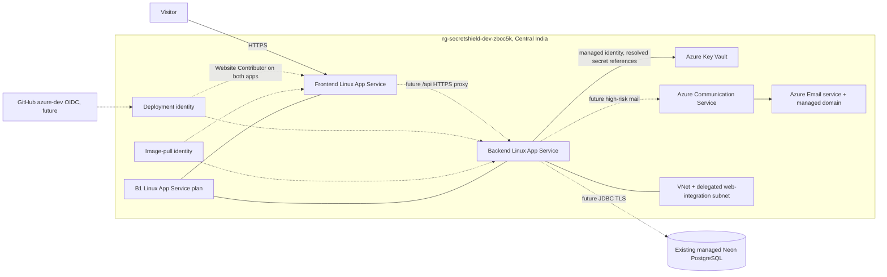

# Azure architecture and inventory (observed 18 October 2026)

This diagram records the **applied M14 infrastructure**, verified against
Terraform state and Azure resource reads. Both public URLs returned HTTP 200
over HTTPS, but they still serve Microsoft's placeholder container. Secret
Shield has not been deployed. The existing Neon PostgreSQL project is outside
the Azure resource group; this plan did not create Azure PostgreSQL or ACR.

Terraform state contains 18 managed objects in the approved plan:

| Group | Applied objects | Verification |
| --- | --- | --- |
| Hosting (3) | B1 Linux service plan; backend and frontend Linux web apps | Azure resource reads show both apps `Running`, HTTPS-only and publicly reachable; each placeholder URL returned HTTP 200. |
| Network (3) | Application resource group, VNet and delegated web-integration subnet | Terraform state and Azure resource inventory. |
| Secrets (3) | RBAC Key Vault, backend `Secrets User` assignment and operator `Secrets Officer` assignment | Vault read shows RBAC and purge protection enabled. Four approved Neon/JWT values were uploaded privately; Azure reports all four backend references `Resolved`. |
| Delivery identity (5) | Deployment identity, GitHub `azure-dev` federated credential, two app-scoped `Website Contributor` assignments, image-pull identity | Terraform state; GitHub environment is **not yet configured**. |
| Notifications (4) | Communication Service, Email service, Azure-managed email domain and domain association | Terraform state; Azure reports the managed domain `Succeeded` and default `DoNotReply` sender username. A real sender address and delivery are **not yet verified**. |

This inventory describes applied infrastructure and secret-reference status.
M15 still needs actual scanned images, GitHub reporting/OIDC setup, deployment, and live API/
notification checks. The protected Terraform Blob state account and USD 20
monthly alert budget are separate pre-existing resources, outside the 18-item
application plan.
