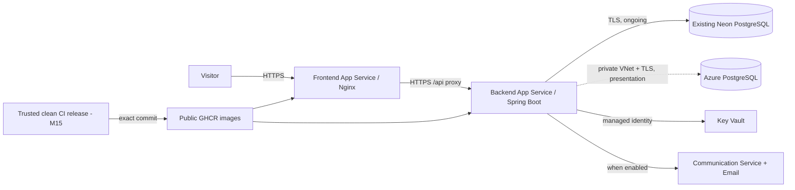

# Azure infrastructure design (M14)

M14 prepares two configurations for the same public website. The **ongoing**
configuration keeps the backend and frontend on one Linux App Service B1 plan,
uses the existing Neon database, and pulls public, exact-commit images from
GitHub Container Registry (GHCR). The **presentation** configuration can add
private Azure PostgreSQL Flexible Server and Azure Container Registry (ACR) for
M14/M15 evidence. Switching databases requires a reviewed data migration;
Terraform does not copy rows between Neon and Azure PostgreSQL. The ongoing
infrastructure is applied with placeholder containers; the optional
presentation configuration is not applied. The protected Terraform state
account is separate. See the [actual Azure inventory](azure-architecture-actual.md).

The frontend proxies `/api` to the backend over HTTPS, so browser login and
API calls stay on one origin. App Service terminates public HTTPS. The backend
gets database/JWT values through Key Vault references in app settings; the
actual values stay outside Terraform and Git. A system-assigned backend identity
has Key Vault `Secrets User` on its vault. Both apps start with a public
Microsoft sample image for infrastructure setup; these placeholders are **not**
Secret Shield. M15 must publish both scanned images and switch `image_source`
to `ghcr` with the same 40-character commit SHA. GHCR packages must be made
public before App Service can pull anonymously. GitHub currently makes public
packages free and permits anonymous public image pulls, but this policy and
Neon's free-plan limits can change. See [GitHub Packages billing](https://docs.github.com/en/packages/learn-github-packages/introduction-to-github-packages),
[GHCR pull rules](https://docs.github.com/en/packages/working-with-a-github-packages-registry/working-with-the-container-registry),
and [Neon Free limits](https://neon.com/blog/neon-free-plan-1-gb-per-project).

The optional Azure PostgreSQL server is on a delegated subnet, with public
access disabled and private DNS linked to the App Service VNet. Its JDBC URL
requires TLS. The temporary Azure database uses a restricted
`secretshield_app` role provisioned after the server is created. The initial
administrator password is a write-only ephemeral Terraform input, never a
runtime app setting. ACR is optional and has no admin credentials; if selected,
App Service pulls with a user-assigned identity and `AcrPull` scoped to that
registry. Do **not** switch `database_source` from `azure` to `neon` after
putting data into Azure PostgreSQL without backing it up and reviewing the
Terraform destroy plan. The ongoing site should use the existing Neon database
from the start unless the presentation specifically needs Azure database data.

A GitHub OIDC identity trusts only the named repository's `azure-dev`
environment. It has `Website Contributor` on the two apps and gains `AcrPush`
only when ACR is provisioned. M15 must protect that GitHub environment and
gate image publishing/deployment on the exact clean commit. No long-lived
Azure client secret is stored in GitHub. The backend may access Key Vault
secrets, but the GitHub identity has no Key Vault or database role.

ACS, Email service, Azure-managed domain, and domain association are defined
in both configurations. `NOTIFICATION_PROVIDER` defaults to `disabled`.
Before enabling `azure`, M15 must confirm the sender and approved recipients,
put the ACS connection string and sender in Key Vault, and run live delivery
checks. A custom domain adds DNS verification. The two ACS resources must use
the same data geography. Key Vault uses RBAC, soft delete, and purge
protection; its public endpoint remains available for an authorized operator
to provision secrets. A private endpoint would require a trusted private
provisioning path.

## Cost and availability

The user selected the **Azure for Students** subscription in **Central India**
and configured a monthly Cost Management budget with 50%, 80%, and 100% alerts.
The Education Hub display rechecked on 19 October 2026 showed **₹9,599 available
credit, 393 days remaining, and expiry on 15 November 2027**. Budget amounts use
the subscription billing currency. The displayed credit is not a
renewal guarantee. Microsoft's [Azure for Students FAQ](https://learn.microsoft.com/en-us/azure/education-hub/faq)
says renewal requires eligible student status or a change to pay-as-you-go;
the live link may stop when the credit expires unless the subscription is
renewed or upgraded. The [free-services list](https://azure.microsoft.com/en-in/free/students/)
includes a 12-month B1ms/32 GiB Azure PostgreSQL allowance, but the subscription's
remaining eligibility must be checked before relying on it.

The [Azure Retail Prices API](https://learn.microsoft.com/en-us/rest/api/cost-management/retail-prices/azure-retail-prices)
reported these Central India USD rates on 18 October 2026:

| Meter | List price | 730-hour/30-day estimate |
| --- | ---: | ---: |
| Linux App Service B1, one plan for both apps | $0.018/hour | $13.14 |
| Linux App Service B2, earlier design | $0.036/hour | $26.28 |
| PostgreSQL B1ms, optional presentation server | $0.0245/hour | $17.89 |
| Azure PostgreSQL 32 GiB storage, optional | $0.131/GB-month | $4.19 |
| ACR Basic, optional | $0.1666/day | $5.00 |

The ongoing B1 + Neon + public GHCR design starts at **about $13.14/month**
for App Service, leaving about $6.86 under the requested cap for Key Vault,
state storage, ACS mail, bandwidth, and other usage. This is an estimate, **not
a guaranteed maximum**. Keep Azure PostgreSQL and ACR off for continuous
operation unless a refreshed estimate supports them. The presentation add-ons
would push a full month above $20 unless the Azure free allowance applies;
even then, monitor usage. Use the [Azure Pricing Calculator](https://azure.microsoft.com/en-us/pricing/calculator/)
and the subscription's Cost Management view before apply.

Neon Free currently includes 1 GiB per project and 100 CU-hours per month;
its compute [suspends after inactivity](https://neon.com/docs/manage/endpoints/)
and resumes on a query. The site can remain reachable, but the first database
request after idle may take longer, and free tiers do not promise uninterrupted
availability. Traffic, a continuously active database, or a change to free
allowances can require a paid plan. Check real usage after launch. Azure budget
alerts send notifications but [do not stop resources](https://learn.microsoft.com/en-us/azure/cost-management-billing/costs/tutorial-acm-create-budgets).

## Inputs, state, and security

Before a live application apply: refresh Azure CLI login, verify the
subscription and credit status, and review the saved plan. A monthly subscription
budget with 50%, 80%, and 100% email alerts is active; verify its amount against
the portal's current billing currency before relying on it. The
protected Blob state account lives in a
separate resource group so a change to the application stack cannot erase
its own state. Use Entra authentication, `Storage Blob Data Contributor` for
the operator on the state container, blob versioning, soft delete, HTTPS/TLS,
and private blob access. State may contain resource IDs and metadata; do not
share state or saved plans.

For the ongoing site, Key Vault needs private `db-url`, `db-username`,
`db-password`, and `jwt-secret` values. Use the JDBC URL and credentials from
the existing Neon project; do not copy them into `.tfvars`. For the optional
Azure database, supply `TF_VAR_postgres_admin_password` privately and create
`db-app-password` for the restricted runtime role. The
[operator guide](azure-terraform-setup.md) gives the exact sequence.

The [App Service VNet guide](https://learn.microsoft.com/en-us/azure/app-service/overview-vnet-integration),
[PostgreSQL private-access guide](https://learn.microsoft.com/en-us/azure/postgresql/connectivity/quickstart-create-connect-server-vnet),
[Key Vault references guide](https://learn.microsoft.com/en-us/azure/app-service/app-service-key-vault-references),
and [Azure GitHub OIDC guide](https://learn.microsoft.com/en-us/azure/developer/github/connect-from-azure-openid-connect)
support the selected controls. Terraform uses pinned AzureRM 4.31.0.

## Status

`terraform fmt`, `terraform validate`, and three mocked plan tests passed. The
protected Central India Blob state account uses Entra sign-in, private blobs,
disabled shared-key access, versioning, and seven-day soft delete. The approved
18-resource plan was applied in two passes after correcting a provider-specific
VNet setting; all 18 resources are now in Terraform state, with no changes or
deletions in the recovery plan. Both public apps run Microsoft's placeholder
container and use HTTPS-only access. The
[M14 apply review](m14-plan-review.md) and
[actual diagram](azure-architecture-actual.md) show observed infrastructure.
Four core Neon/JWT Key Vault references report `Resolved`. Scanned GHCR images,
real app deployment, and ACS delivery remain pending.
