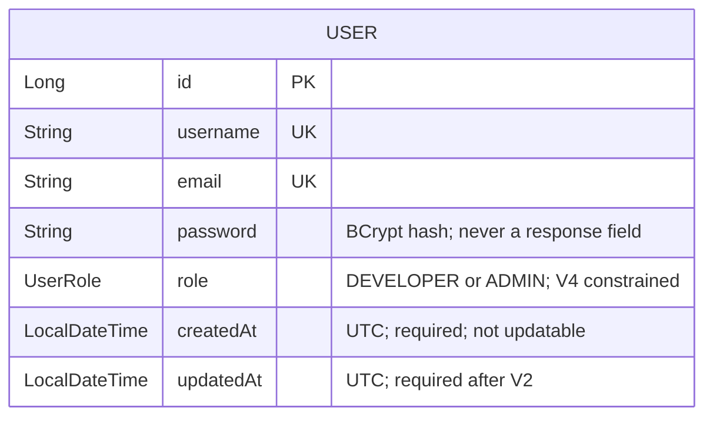
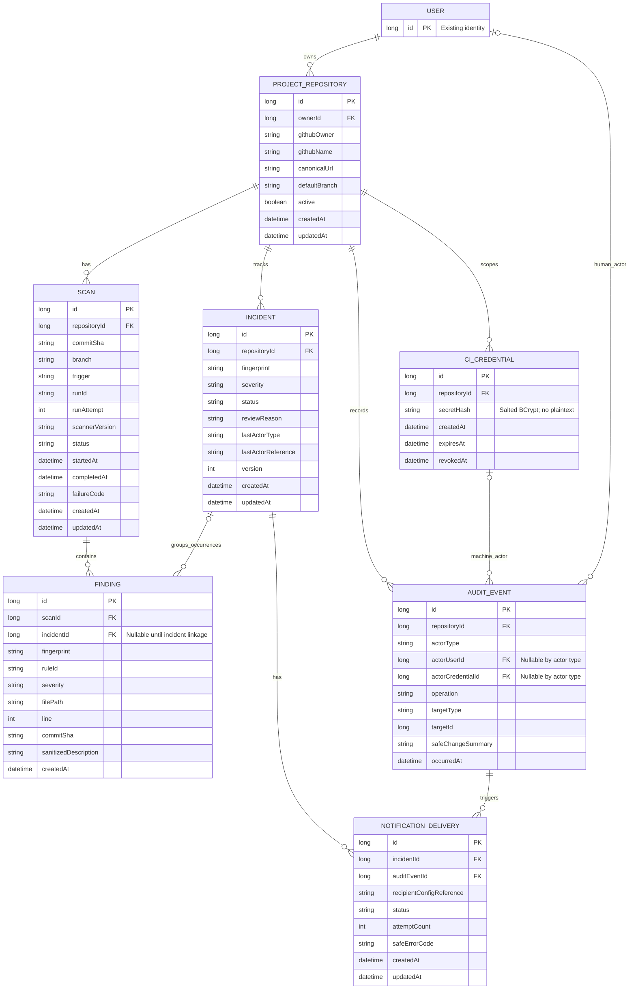

# Secret Shield data model

Prepared by Member 1 on 11 October 2026 for M01.6.

The implemented model below is checked against the Java entity, V1–V4 migrations,
DTOs, configuration, and PostgreSQL integration tests. The future model is the
finalized M01.1 design in [api-contract.md](api-contract.md), based on the scope in
[PROJECT_OVERVIEW.md](../PROJECT_OVERVIEW.md) and [MODULE_TODO.md](../MODULE_TODO.md).
Future entities remain unimplemented until their named modules; design completion
does not imply their tables or endpoints exist.

## Implemented entity: User

`User` maps to the `users` table. It is currently the only application JPA entity.
There are no application entity relationships or foreign keys yet.

| Java field | Java type | Current mapping and behavior |
| --- | --- | --- |
| `id` | `Long` | Primary key, generated with `IDENTITY`; no client-supplied ID during registration |
| `username` | `String` | Required and unique; registration checks duplicates before saving |
| `email` | `String` | Required and unique; registration checks duplicates; M02 normalizes by trimming/lowercasing; V3 enforces canonical email and normalized uniqueness |
| `password` | `String` | Required; stores a BCrypt hash, not the submitted password; omitted from response DTOs |
| `role` | `UserRole` | Required `DEVELOPER` or `ADMIN`; V4 check constraint; public registration assigns DEVELOPER; controlled existing-user bootstrap only |
| `createdAt` | `LocalDateTime` | Required; JPA `@PrePersist` assigns UTC; `updatable=false` prevents ordinary Hibernate updates |
| `updatedAt` | `LocalDateTime` | Required after V2 backfill; initialized on persist and refreshed on JPA update |

The diagram uses Java field names/types, not a migration's physical column names.
`PK` means primary key and `UK` means a unique constraint.

Registration returns `id`, `username`, `email`, and `role`. Login returns the JWT
`token`, `username`, `email`, and `role`. Neither response serializes the entity's
password hash or timestamps. See the existing `RegisterResponse` and `LoginResponse`
records; the shared failure envelope is documented in [api-contract.md](api-contract.md).

New timestamp values represent UTC while retaining the existing `LocalDateTime`
storage type. Historical local-time values are not reinterpreted by this document.
V2 backfills null legacy `updatedAt` values from `createdAt`, then enforces NOT NULL.
JPA lifecycle callbacks do not cover direct SQL/bulk JPQL updates.

## Current schema and verification boundary

V1 creates the six original user columns; V2 adds/backfills `updated_at` and makes
it required. All profiles use Hibernate `ddl-auto: validate`; Flyway owns schema
changes. Existing users require explicit, schema-checked adoption at baseline version
0. See [database-migrations.md](database-migrations.md) for the fresh/existing paths.
See [runtime-configuration.md](runtime-configuration.md) and [testing.md](testing.md).

Integration tests verified PostgreSQL persistence, email uniqueness, BCrypt storage,
actual timestamp callbacks, fresh/repeat migrations, and existing-user preservation.
Historical timezone conversion is intentionally not performed. The runner's
`test_support.test_run_marker` is test infrastructure, not an application entity.

## Finalized design for future entities and relationships

Only `User` exists in the following diagram. Every other entity and every
relationship is planned. Field names, cardinality, ID types and integrity policies
match the M01.1 contract. Each later module supplies its own physical DDL/constraint
names; Module 1 migrations deliberately create only users. `long`, `string`, and
`datetime` are logical types, not SQL syntax. DTO resource IDs are decimal strings.

| Entity | Planned responsibility | Implementation step |
| --- | --- | --- |
| User | Repository owner and human actor; normalized email and controlled role | Existing; email normalized in M02, roles constrained in M03 |
| ProjectRepository | User-owned GitHub identity, canonical URL, default branch, active flag | M04.1 |
| Scan | Repository/commit/run identity, scanner version, outcome, and timing | M05.1 |
| Finding | One scan's sanitized occurrence, stable fingerprint, rule, severity, and safe location | M07.1 |
| Incident | Repository-scoped review record grouping repeated finding occurrences | M08.1 |
| CiCredential | Repository-scoped hashed machine credential, expiry and revocation | M05.3 |
| AuditEvent | Append-only repository history with operation, actor, time, and safe change summary | M08.3 |
| NotificationDelivery | Delivery outcome/retry evidence for an incident event and recipient configuration | M10.1 |

`||` means exactly one, `o|` means zero or one, and `o{` means zero or many.
For example, each proposed scan has one repository; a repository may have no scans.
A finding has one scan and, in this proposed direct-FK design, at most one incident;
an incident groups occurrences from multiple scans. Optional linkage allows finding
ingestion to precede incident creation. The chosen representation is a direct
Finding.incidentId foreign key, not a many-to-many occurrence table.

Audit actorType selects exactly one nullable actor FK: USER uses actorUserId,
MACHINE uses actorCredentialId, SYSTEM has neither. Machine actors must be scoped
to the same repository. TargetType/targetId form a typed polymorphic target reference;
service validation checks its repository. Notifications reference the triggering
audit event and an authorized private recipient configuration key; no recipient
table is assumed. These checks are implementation requirements for later modules.

## Agreed invariants for later implementation

- Repository ownership belongs to a user. Later authorization must check ownership
  or explicitly approved admin rights at every nested-resource operation.
- Repository identity uses lowercase GitHub owner/name and is unique per owning user.
- CI scan identity is unique by repository/run ID/attempt/commit. An identical replay
  reuses the result; a different payload for that identity returns 409.
- Findings store sanitized metadata only. They must not store raw secrets, source
  snippets, raw scanner reports, or bearer tokens. Fingerprint derivation, uniqueness,
  and rule-to-severity fallback are specified in the API contract for M07.1.
- An incident groups one stable finding identity within a repository. Every linked
  occurrence must belong to that same repository through its scan. The eventual
  schema/service contract must enforce that cross-resource invariant.
- Proposed scan states are `QUEUED`, `RUNNING`, `CLEAN`, `FINDINGS_DETECTED`, `FAILED`;
  incident review states are `OPEN`, `RESOLVED`, `IGNORED`. Transitions, automatic
  reopening after resolution, reasons, and optimistic `version` are specified in the contract.
- Incident review never changes a scan outcome or overrides the security gate.
  Deactivating a repository must retain scan, finding, incident, and audit evidence.
- Audit history is append-only. Delivery uniqueness is audit event plus recipient
  reference; states/retries are in the contract. HIGH/CRITICAL findings qualify for alerts.

## Review status and remaining acceptance

Member 1 checked the implemented field table/diagram against `User.java`, V1/V2
migrations, `AuthService`, response records, and real PostgreSQL tests. The future
diagram and invariants match the finalized API contract, including the incident
link, machine credential actor model, notification event reference, and severity policy.
Fresh/existing migration tests preserve users and backfill timestamps. M02 normalizes
email; M03 constrains and normalizes roles without silently promoting unknown values.
DTO exposure omits hashes/secret material. No future resource table or API is claimed
as implemented by this documentation; their migrations must maintain this contract.

M02 adds V3 email normalization and collision refusal while retaining existing
identities and hashes. M03 adds V4 and maps role to `UserRole`. GET /api/auth/me
exposes only string id, username, normalized email and the controlled role.
