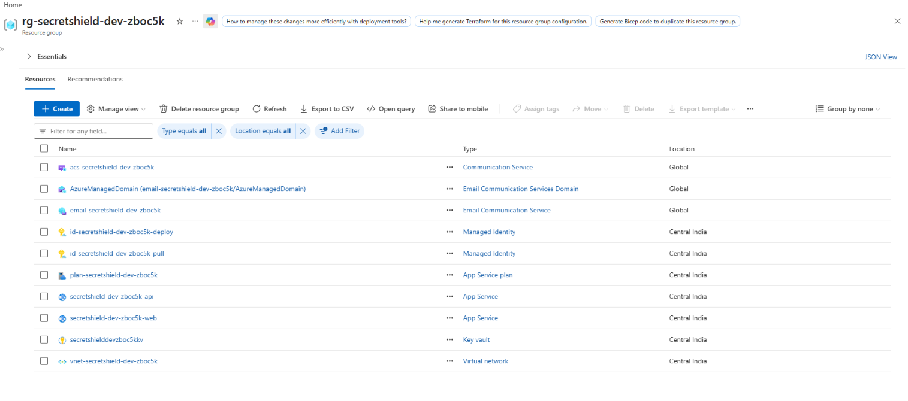
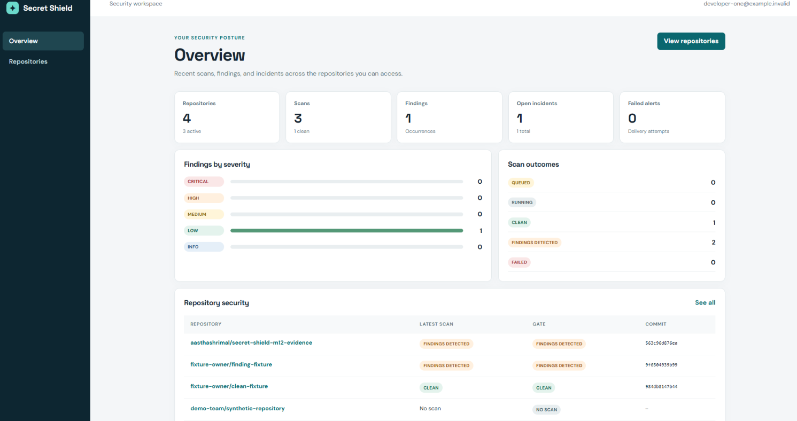
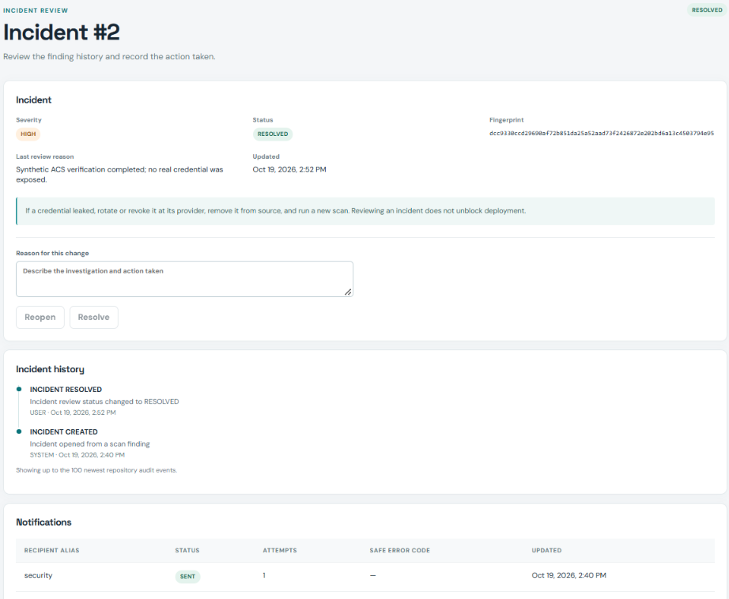
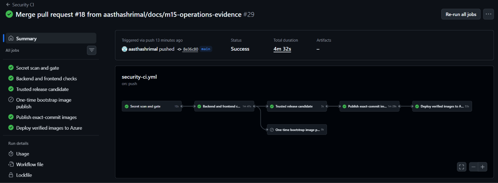

# Azure deployment and operations

The approved [M14 infrastructure](azure-architecture-actual.md) now has two
Linux App Services on one B1 plan in Central India, Key Vault, and ACS Email;
the database remains on Neon. Exact-commit GHCR images are public and trusted
`main` pushes deploy both applications through the protected `azure-dev`
environment. Run `39199309614` deployed commit
`9378f1a41c8058766030f2dba4b0bae0ae58a1f7`; backend, frontend, and proxy
health checks passed. The student credit display expires **15 November 2026**;
check renewal before promising a permanent GitHub website link. The configured
budget sends alerts but does not shut down billable resources.

## Activation order after separate approval of each consequential action

1. **Completed:** the approved 18-resource M14 plan was applied and its
   [actual inventory](azure-architecture-actual.md) verified. Do not reapply
   `infra/m14.tfplan`; inspect a fresh plan before any future infrastructure
   change. Both apps currently run public exact-SHA GHCR containers.
2. **Secrets completed:** the private Neon JDBC URL with
   TLS, username, password, and JWT secret passed local validation and were
   uploaded after separate approval. Azure reports all four Key Vault app
   setting references `Resolved`. The helper
   `powershell -NoProfile -File scripts/prepare-azure-secrets.ps1` can validate
   future input without uploading. Do not rerun with `-Apply` unless rotating
   those values: it creates new secret versions. The approved ACS connection,
   sender, and recipient configuration were uploaded separately with
   `-NotificationsOnly`; all notification references resolve and live delivery
   is verified. Future rotation still requires separate review.
3. **Environment completed:** GitHub CLI authentication was verified, and
   `scripts/prepare-github-environment.ps1 -Apply` created `azure-dev` with a
   `main`-only deployment branch rule and set the three non-secret OIDC identity
   variables. A second run succeeded idempotently. Publishing and deployment
   switches are now enabled after their separate approvals. `main` is protected
   with required checks **Secret
   scan and gate** and **Backend and frontend checks**. The dry-run helper
   `scripts/prepare-github-branch-protection.ps1` previews those exact settings;
   its `-Apply` switch changes GitHub only after separate review. GitHub treated
   an earlier zero-approval PR rule as requiring a reviewer. After explicit
   approval, only that review rule was removed; both required checks,
   administrator enforcement, conversation resolution, and force-push/deletion
   protection remain enabled.
4. **Bootstrap completed:** the one-time publisher produced the first exact-SHA
   backend/frontend images after clean checks. The packages were made public,
   the first image switch passed health checks, and
   `BOOTSTRAP_PUBLISH_ENABLED` was disabled again. For a future independent
   environment, enable
   `BOOTSTRAP_PUBLISH_ENABLED` with
   `scripts/prepare-github-environment.ps1 -Apply -EnableBootstrapPublishing`.
   Manually dispatch **Security CI** on `main`. The bootstrap job needs a
   `CLEAN` scan and passing backend/frontend checks, then publishes only that
   exact SHA; it never deploys. Make both GHCR packages public after reviewing
   their visibility. Preview
   `scripts/bootstrap-cloud-deploy.ps1 -CommitSha <40-char-sha> -RunId <run-id>`;
   after separate deployment approval, add `-Apply`. It verifies the GitHub
   run and anonymous image manifests, switches both apps, and checks real
   backend/proxy health. Disable the one-time flag using
   `-DisableBootstrapPublishing` on the GitHub environment helper. Keep the
   normal publish/deploy flags off until reporting succeeds.
5. **CI reporting completed:** a repository-scoped machine credential is stored
   as a GitHub Actions secret and trusted workflow reports are acknowledged by
   the live backend. For a future replacement credential, run
   `powershell -NoProfile -File scripts/prepare-ci-reporting.ps1` for a local
   preview. After approval, `-Apply` asks for your Secret Shield login,
   finds/creates the repository record, issues one machine credential, and
   stores it in GitHub Actions secrets. The one-time value is never printed.
   A failure attempts to revoke the issued credential. A trusted `main` push
   must get a matching backend acknowledgement before it can publish images.
6. **Normal publication completed:** `GHCR_PUBLISH_ENABLED` is enabled and clean,
   reported `main` commits publish both exact-SHA images. To reproduce the setup,
   run
   `powershell -NoProfile -File scripts/prepare-github-environment.ps1 -Apply
   -EnablePublishing`. The next clean, reported `main` push builds and pushes
   backend/frontend images tagged with that exact commit SHA. GHCR packages
   under a personal account start **private**; GitHub currently requires the
   package owner to make both packages **Public** in each package's settings.
   This visibility change is consequential and cannot be assumed from the
   public source repository. The deploy job checks anonymous image pulls and
   fails before Azure sign-in if either image remains private.
7. **Normal deployment completed:** `AZURE_DEPLOY_ENABLED` is enabled. A clean,
   reported `main` push signs in through environment-scoped OIDC, switches both
   App Services to the same exact SHA, and checks all three health paths. To
   reproduce the setting, run
   `powershell -NoProfile -File scripts/prepare-github-environment.ps1 -Apply
   -EnablePublishing -EnableDeployment`. A new clean, reported `main` push
   uses an environment-scoped GitHub OIDC token, changes both App Services to
   the same SHA-tagged images, and checks backend, frontend, and `/api` proxy
   health. The workflow does **not** grant Azure credentials to PR jobs.

The ignored `infra/terraform.tfvars` selects `image_source="ghcr"` and the
currently deployed exact SHA. Update `image_tag` after each successful CI
deployment before a later Terraform plan, or Terraform may propose rolling the
apps back. Review every change/destroy action before an infrastructure apply.
The CI job updates only the app image settings, using `Website Contributor` on
those two apps; it does not access Terraform state.

## Live checks and incident response

After deployment, verify `GET /api/health/live` on the backend and through the
frontend proxy. Then use a synthetic account to log in and read the dashboard;
the liveness endpoint alone does not test Neon, migrations, or JWT. Check one
trusted clean GitHub run and compare its run ID, attempt, and SHA with the
backend scan record. A synthetic-finding or scanner-error run must skip build,
publish, and deploy. Validate an incident transition, audit event, blocked
gate, and approved high-risk recipient with ACS delivery evidence before
checking M10.4/M15.3 complete.

Use the backend scan/gate/notification APIs for safe operational status. The
`FAILED` scan outcome, reporting acknowledgement, notification `FAILED`
status, attempt count, and `safeErrorCode` are the first diagnostic signals.
Both App Services now retain information-level application logs and HTTP logs
for three days with a 35 MB per-app filesystem cap. Detailed errors and failed
request tracing remain disabled. A private download audit found no passwords,
JWTs, ACS keys, bearer tokens, credential assignments, or credential-bearing
URLs. Flyway INFO output did include the non-credential database endpoint, so
`application.yml` suppresses only `org.flywaydb.core.FlywayExecutor` INFO output;
merged-main run `39242095907` deployed that change. A private scan of 39 files
found zero private-value matches in the new deployment window and zero credential
patterns. Eighteen retained pre-fix endpoint lines contain no credential and
expire under the three-day policy. [Microsoft's App Service
guide](https://learn.microsoft.com/en-us/azure/app-service/configure-custom-container)
documents log access. Never publish raw scanner reports, JWTs, DB URLs/passwords,
ACS keys, recipient addresses, or whole Terraform state/plan files in logs or
GitHub artifacts.

Keep a tested Neon backup outside Git. Run
`powershell -NoProfile -File scripts/verify-neon-backup.ps1 -ValidateOnly`, then
use `-KeepBackup` for a private custom-format dump and restore into a separate
disposable PostgreSQL 18 container. On 19 October 2026 this check produced a
nonempty dump, restored public tables and Flyway history, removed its temporary
container and secret files, and retained the dump only under ignored `target/`.
Copy a retained operational backup to approved private storage before `mvn clean`.
Neon also documents
[Postgres migration tools](https://neon.com/tools). Do not restore over the live
database without a separate review. Record backup time, database identifier,
and restore test result without storing credentials in the report. Verify any
Neon-native restore window against the current plan before relying on it.

For an application rollback, find the last known-good clean, reported commit
SHA from GitHub and confirm both images are public. With deployment authorized,
set *both* App Services back to those exact SHA-tagged images using
`az webapp config container set`, then repeat liveness and login checks. Keep
the database schema backward-compatible with that image; if a migration is
incompatible, use the reviewed database backup/recovery procedure first.
Disable `AZURE_DEPLOY_ENABLED` before debugging repeated deploy failures.
Never use `terraform destroy` as a routine shutdown: it may delete app data
and leave protected state/Key Vault recovery objects. Teardown and resource
retention require a separate reviewed cost/data decision. For the current
deployment, `9378f1a41c8058766030f2dba4b0bae0ae58a1f7` is the reviewed previous
healthy exact-SHA rollback candidate; it was not redeployed because the current
release passed. The current retention decision is to keep both apps, Key Vault,
ACS, protected Terraform state, Neon data, and the private tested dump through
the presentation. Any later teardown must preserve required evidence/data and
receive separate approval.

## Reviewed cloud evidence

The resource-group capture shows only safe resource names, types and locations.
Terraform manages the Azure application resources recorded in the actual
architecture inventory. Neon database ownership, approved recipient selection,
private secret upload, GitHub environment settings and budget review remain
explicit operator prerequisites rather than Terraform-created secrets/accounts.

The deployed dashboard shows current repository, scan, finding, incident and
gate summaries over the live HTTPS frontend/API proxy. The visible
`example.invalid` identity is synthetic.

The incident capture links HIGH incident 2 to its creation/resolution history
and one-attempt `SENT` notification without showing the recipient address or
message body.

Final run `39247034941` published and deployed exact commit
`8e36c800eecfb338bca68c4654393b37db0eff03`; all required jobs passed and the
bootstrap publisher stayed disabled.

GHCR publication/deployment, live login/dashboard/scan/incident/audit/gate, real
ACS success plus failure/retry, bounded/redacted operational logging, reviewed
rollback/teardown procedures, Neon backup/restore and sanitized screenshots are
verified.
